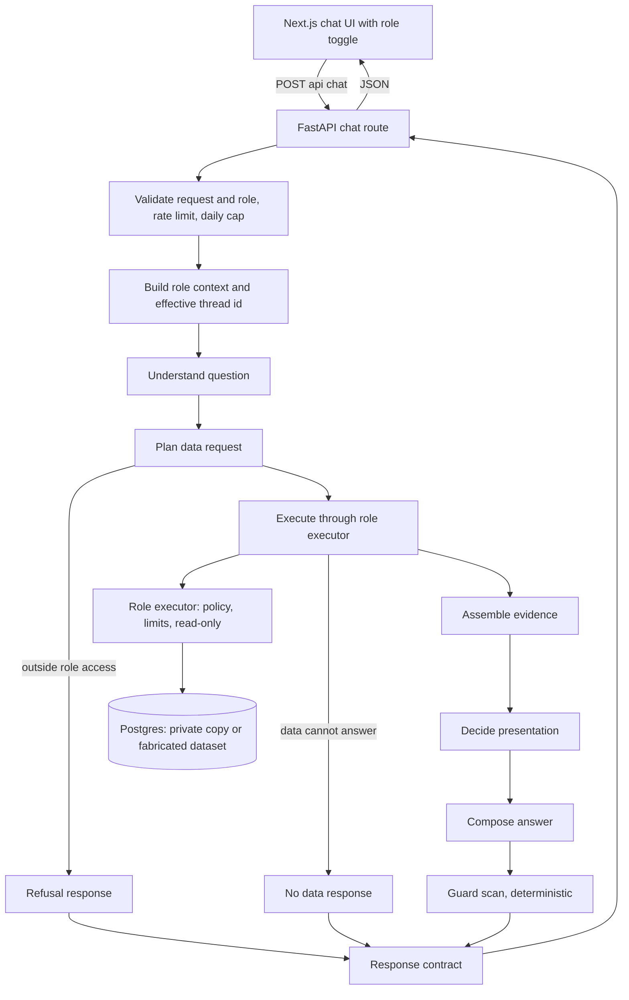
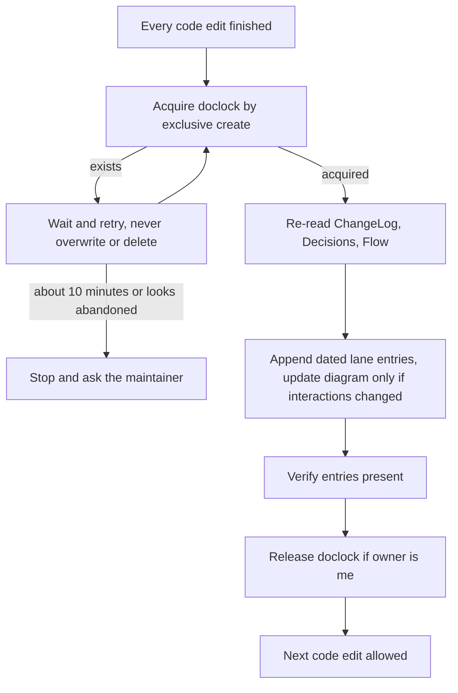

# Flow

Describes planned interactions. Nothing is implemented yet. Update only when interactions actually change. Lock protocol is in AGENTS.md.

## Request flow (planned)

1. The frontend sends POST `/api/chat` with `role`, `thread_id` and `message`.
2. The backend validates the request and role, applies the per-IP rate limit and daily cap, and builds the role context and the effective thread id.
3. The LangGraph agent runs: understand the question, plan a data request, execute it through the role executor, assemble evidence, decide the presentation, compose the answer, run the guard scan.
4. The role executor applies the role policy and limits, then reads from Postgres (private copy locally, fabricated dataset when hosted).
5. Refusals and no-data outcomes return as normal responses with a `status` field.
6. The backend returns the JSON contract defined in docs/api.md. The frontend renders text, table or chart plus the evidence panel.

## Maintenance flow (planned)

The maintenance rule is literal: after every code edit, ChangeLog.md, Decisions.md and Flow.md are updated under the `.doclock` protocol before the next code edit. Documentation-only bookkeeping (the ChangeLog, Decisions and Flow updates themselves, and saving the planning documents at scaffold time) does not trigger another cycle.

## Flow update log

2026-11-18 | Planning | initial planned flow recorded, no implementation
2026-11-18 | Planning | changed: maintenance diagram clarified to every code edit