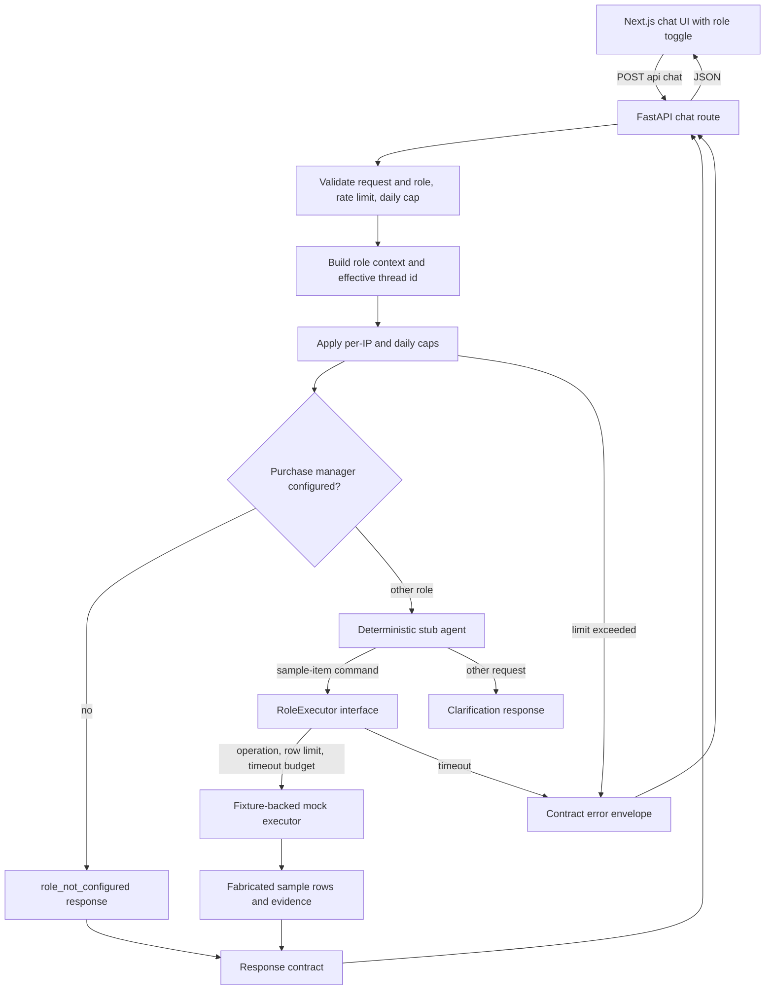
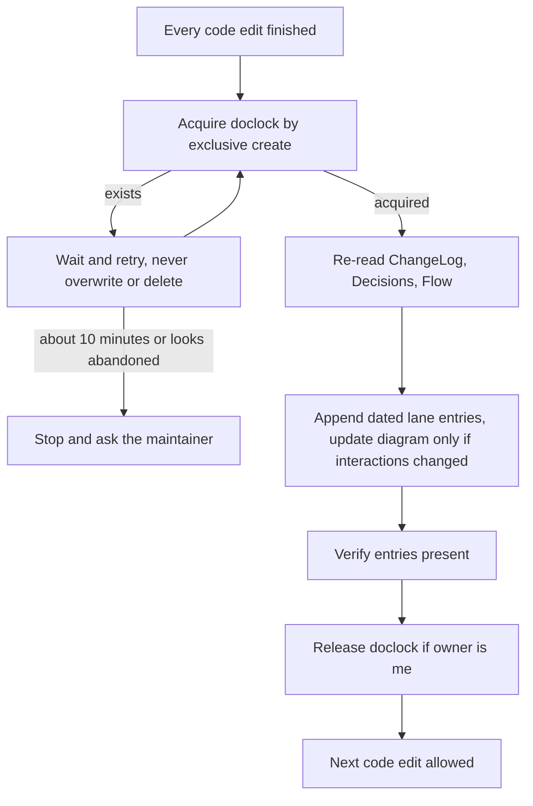
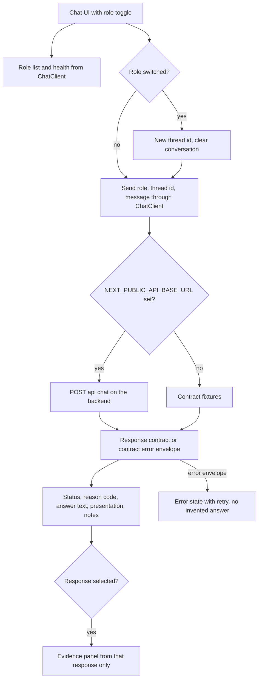

# Flow

Describes planned interactions. Nothing is implemented yet. Update only when interactions actually change. Lock protocol is in AGENTS.md.

## Request flow

1. The frontend sends POST `/api/chat` with `role`, `thread_id` and `message`.
2. The backend validates the body and role, assigns a request id, applies the per-IP rate limit and daily cap, and builds a role context and effective thread id.
3. `purchase_manager` returns `role_not_configured`. The current stub agent clarifies other requests and runs only a fixed sample-item operation for explicit demo commands.
4. The `RoleExecutor` interface passes the operation, row limit and query timeout budget to the fixture-backed mock, which returns fabricated rows and evidence within the configured row cap. No database connection is made.
5. The backend returns the JSON contract defined in docs/api.md. Validation, rate-limit, daily-cap and timeout failures use the contract error envelope. The frontend renders text, table or chart plus the evidence panel.

## Maintenance flow (planned)

The maintenance rule is literal: after every code edit, ChangeLog.md, Decisions.md and Flow.md are updated under the `.doclock` protocol before the next code edit. Documentation-only bookkeeping (the ChangeLog, Decisions and Flow updates themselves, and saving the planning documents at scaffold time) does not trigger another cycle.

## Frontend flow (implemented)

The UI is a pure renderer of the response contract. It holds no role rules. Two data paths sit behind one `ChatClient` interface.

1. On load the UI asks the client for the role list and the health status. When `NEXT_PUBLIC_API_BASE_URL` is set these are GET `/api/roles` and GET `/api/health`. Otherwise the contract fixtures answer them.
2. The role toggle sets the role, starts a new thread id and clears the visible conversation, so the client never mixes history across roles.
3. A message is sent through the client with the selected role, the thread id and the message text. While the request is pending the UI shows a loading state and renders no answer.
4. A response is rendered as it arrives: status badge, reason code, answer text, then the text, table or chart presentation, then the notes. Selecting a response fills the evidence panel from that response's evidence entries only.
5. A transport failure shows the contract error envelope message and code, or a plain connection message when no envelope was returned, and offers a retry. No answer text is invented for a failure.
6. When the contract fixtures are in use, the sidebar lists one entry per fixture so every status and presentation can be seen without the UI guessing intent. A header badge says the fixtures come from contract v0.1.

## Flow update log

2026-11-18 | Planning | initial planned flow recorded, no implementation
2026-11-18 | Planning | changed: maintenance diagram clarified to every code edit
2026-11-18 | Lane 0 | flow unchanged
2026-11-18 | Lane 0 | flow unchanged
2026-11-18 | Lane 0 | flow unchanged
2026-11-18 | Lane 0 | lane0-c4b2 | flow unchanged
2026-11-18 | Lane A | changed: backend API flow now uses role validation, in-process limits, the stub agent and fabricated mock executor
2026-11-18 | Lane A | flow unchanged
2026-11-18 | Lane A | changed: query timeout budget now passes through the agent stub to RoleExecutor
2026-11-18 | Lane D | flow unchanged
2026-11-18 | Lane D | flow unchanged
2026-11-18 | Lane F | laneF-b81c | flow unchanged
2026-11-18 | Lane C | laneC-4f2b | changed: frontend implemented, added a ChatClient seam with an HTTP path and a placeholder fixture path, role switch resets the thread id, and the evidence panel is filled from the selected response only
2026-11-18 | Lane A | flow unchanged
2026-11-18 | Lane D | flow unchanged
2026-11-18 | Lane C | laneC-4b1e | changed: fixture path now serves Lane A's frozen contract fixtures instead of placeholders, and the live fixture client mirrors the stub agent; interactions and the ChatClient seam are unchanged
2026-11-18 | Lane E | laneE-8e4a | flow unchanged
2026-11-18 | Lane A | flow unchanged
